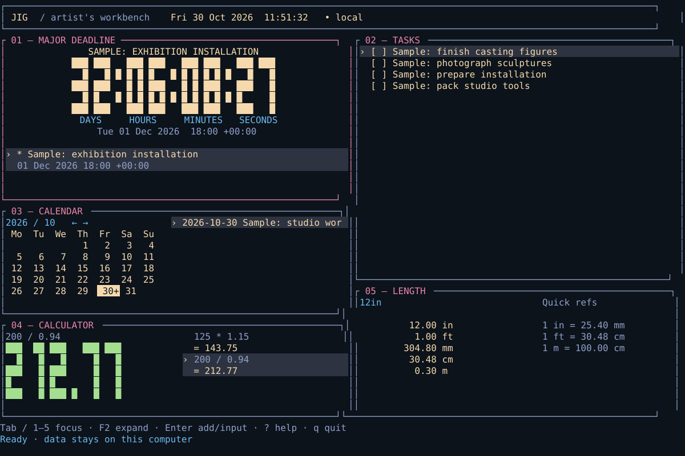

# Jig

You are a small Small Giant Psionicist.

Jig is a small, local artist's workbench in Rust. The browser starts in **Tasks**
and remembers your workspace. **Notes**, **Sheet**, and **Workbench** remain in
the top bar. Tasks, their Gantt timeline, notes, calculator/converter, calendar,
optional weather and STL viewer use the same portable state. The native CLI and Ratatui terminal
interface share the Rust core; running `jig` still opens the terminal dashboard.

No accounts, telemetry, database or backend. Files are processed on your device.
The [browser app](https://biraz.dev/Jig/) starts with your saved data or an empty
personal document. Clearly labelled samples are available through **Sample mode**
or `?sample=1`. Personal documents are never published by the Pages build.

## Spreadsheet

The dark grid has familiar top menus, a formula bar, a formatting toolbar and
named sheet tabs. Click a cell and type, double-click or press **F2** to edit;
**Enter** commits, **Esc** cancels. Drag or Shift-click to select a range.
Use the address field to jump to `B12` or select `A1:D20`.

- Numbers, percentages, booleans, ISO dates (`2026-11-11`) and text. Prefix an
  apostrophe to keep text such as `'0012` literal.
- Arithmetic, parentheses, comparisons, powers and percentages:
  `=(A1+B2)*1.15`, `=A1^2`, `=IF(B2>100,"Review","OK")`.
- Relative and anchored references (`A1`, `$A$1`, `A$1`, `$A1`), ranges and named
  sheet references such as `='Clay tests'!B2`.
- `SUM`, `AVERAGE`, `MIN`, `MAX`, `COUNT`, `IF`, `ABS`, `ROUND`, `CONVERT`, `DATE`, `TODAY`,
  `DAY`, `MONTH`, `YEAR`, `TRUE` and `FALSE`. Dates can be subtracted for durations
  or offset by a number of days. `TODAY()` follows the local calendar day.
- Mono, Sans and Serif fonts; sizes 9–32; bold, italic, underline, strikeout,
  left/center/right alignment, text/fill colors and borders. Auto alignment keeps
  numbers on the right and text on the left. General/Number/Percent/USD/Date
  formats are available; USD is the only currency offered for new formatting.
  Existing foreign-currency formats in imported documents remain intact.
  Display precision never rounds saved inputs.
- Insert/delete rows and columns, merge/unmerge selected cells, add/rename/delete
  tabs. Structural changes update references. Merging rejects ranges that would
  hide existing cell content.
- Double-click a sheet tab to rename it. The **+ / -** buttons beside the tabs
  add a sheet or delete the active one; deletion uses inline confirmation and can
  be undone. The final sheet cannot be deleted.
- Right-click a row number or column letter (or touch and hold) to insert above/
  below or left/right, or delete. Shift-click selects a span of headers and the
  menu acts on the whole span. **Shift-F10** opens the menu for selected headers;
  the Insert menu also provides keyboard and touch access.
- **Borders** offers no/all/outside/inner borders, horizontal or vertical lines,
  and individual top/bottom/left/right edges. Horizontal and vertical presets
  include the corresponding outside edges; individual edges add to existing
  borders. Merged cells retain a single perimeter. Alignment, strike and borders
  survive JSON and standard ODS round trips and appear in PDF exports.
- Alignment uses familiar line icons. The border icon opens a compact grid of
  previews: solid lines show the affected edges and dashed guides show the
  remaining grid. Controls have named tooltips and keyboard focus feedback;
  Tab and Space/Enter operate the same controls from the keyboard.
- Copy and paste rectangular cells. Copies made inside Jig translate relative
  formula references when pasted elsewhere; pasted tab-separated text fills a
  block. Clear removes contents while retaining formatting. **Undo** covers sheet
  changes alongside existing task and workbench changes.

The grid paints visible cells and caches calculated values until edits or a local
calendar-day change. Each sheet has **1,000 rows × 52 columns (A–AZ)**; a workbook
has up to **16 sheets**, **20,000 populated/styled cells** and **1 MiB of cell input**.
Formula work is bounded. Errors such as `#REF!`, `#DIV/0!`, circular references and
unsupported functions remain visible. A number or date too wide for its cell
shows `####`; select it to inspect the full value and saved input.

### Conversion formulas

Put a numeric centimeter measurement in `A1`, then use
`=CONVERT(A1,"cm","in")` in another cell for inches. Changing `A1` recalculates
the conversion and any formulas using it. Unit names can also come from cells,
as in `=CONVERT(A1,B1,C1)` when `B1` contains `cm` and `C1` contains `in`.

Supported lengths are `mm`, `cm`, `m`, `in` and `ft`, including their spelled-out
aliases. Add `2` for area or `3` for volume (`cm2`, `in2`, `cm3`, `in3`). Units
must describe the same dimension. This converts physical measurements; costs
come from ordinary arithmetic using your own rate.

| Calculation | Formula |
| --- | --- |
| Centimeters to inches | `=CONVERT(A1,"cm","in")` |
| Area from two centimeter dimensions, in square inches | `=CONVERT(A1*B1,"cm2","in2")` |
| Volume from three centimeter dimensions, in cubic inches | `=CONVERT(A1*B1*C1,"cm3","in3")` |
| Cost at a per-inch rate stored in `D1` | `=CONVERT(A1,"cm","in")*D1` |

Conversions retain calculation precision; the usual display precision controls
what is shown. Unknown units, incompatible dimensions and invalid arguments
produce `#VALUE!`; an overflowing result produces `#NUM!`. ODS and JSON retain
the formula and its references.

### Documents, CSV and printing

**File → Save ODS** downloads `jig.ods`, the main portable document. Standard
OpenDocument cells carry formulas, typed values, formats, merges and sheet names.
A Jig metadata entry also retains the complete state: tasks, linked deadlines,
colors, charts, preferences, calendar notes and calculator history. Keep this
whole-document scope in mind when sharing an ODS file.

**Open ODS** shows an import summary before replacing saved data. An ordinary ODS
from another editor replaces the workbook and keeps your existing Jig tools.
When an exported Jig ODS is edited externally, its visible spreadsheet changes
are imported while its embedded Jig task/history data is retained. Jig supports
its documented formula subset; it does not promise full Excel or LibreOffice
compatibility. ODS charts are exported as SVG previews, with editable Jig chart
specifications in metadata. Foreign native ODS chart objects are not imported.
Browser ODS input is limited to 10 MiB; the core bounds expanded ZIP/XML content.

**Import CSV** fills cells starting at the selection. **Export CSV values** writes
one sheet's evaluated values at stored precision; formulas, styles, other sheets
and tasks require ODS or a Jig JSON backup. CSV input is UTF-8 and limited to 2 MiB.

**File → Export PDF** prints the active sheet's used area, or the selected range
when more than one cell is selected, followed by its relevant charts as vector
pages. A4 landscape pages repeat row/column labels and include page numbers.
Fonts are embedded with Unicode mappings; number/date/currency formats, fills,
borders and merges are retained. Long cell text clips at its cell boundary;
oversized numeric values show `####`. The export is capped at 200 pages.

### Charts and tasks

Select a table and choose **Insert → Chart**. Pie and bar charts read labels and
numeric values from the first two columns; Gantt charts read labels, start dates
and due dates from three columns. An optional first header row is recognized.
Chart results follow changes to their source cells. **View → Charts** opens the
inline gallery, where charts can be renamed or removed.

**Tasks** opens the existing checklist and calendar/timeline. Add a task, give it
an optional due date, and star it to drive the featured countdown in Workbench.
**Gantt from Jig tasks** reads these same records directly, including their
colors and completion status. Editing a task updates its live chart; there is no
second copy of the task to maintain.

### Sheet keys

| Key | Action |
| --- | --- |
| Arrows / Shift-Arrows | Move between cells / extend selection |
| Tab / Shift-Tab | Next / previous cell |
| Enter / F2 | Edit the selected cell |
| Ctrl-G | Go to a cell or range |
| Ctrl-Home / Ctrl-End | First cell / end of used area |
| Ctrl-C / Ctrl-V | Copy / paste cells |
| Shift-F10 on selected row/column headers | Insert/delete context menu |
| Delete / Backspace | Clear selected contents |
| Shift-F11 | Add a sheet |
| Alt-PageUp / Alt-PageDown | Previous / next sheet |
| Ctrl-S / Ctrl-O / Ctrl-P | Download ODS / open ODS / export PDF |
| Ctrl-Z outside text fields | Undo a Jig change |
| Ctrl-Alt-2 | Tasks |
| Ctrl-Alt-W | Switch Sheet / Workbench |

Text fields retain their normal editing shortcuts. File and Edit menus also
provide pointer/touch access to these actions.

### Import statement PDFs and images

**File → Import PDF or image…** selects local PDFs, PNGs or JPEGs for review.
This supports gathering statement and transaction information into cells for
preparation. Review extracted rows, correct their contents and confirm the
destination before inserting them. Text PDFs can be read directly; scanned PDFs
and screenshots need the optional OCR step.

Document text extraction runs locally. OCR also processes pages in the browser;
its recognition assets must be loaded before use. File contents are not sent to
an OCR service. The source PDFs/images remain session-only; confirmed cell values
are saved with the workbook. The browser file picker accepts up to 20 documents,
10 MiB each and 50 MiB total. Verify dates, signs, decimal places and totals
against the originals. Jig does not classify accounts or calculate/file taxes.
Explicit foreign-currency markers in columns mapped to USD are flagged rather
than relabelled as dollars; review can retain those original values as text.

## Build and run on Linux

Install stable Rust with rustup, then:

```sh
git clone https://github.com/biraz-dev/Jig.git
cd Jig
cargo build --locked --release
./target/release/jig
cargo install --locked --path .  # optional: installs in ~/.cargo/bin
```

This runs the native terminal dashboard and CLI. The graphical Sheet workspace
is currently the browser application; there is no native graphical binary yet.
A UTF-8 terminal is recommended. Set IBM Plex Mono in your terminal preferences
if installed. Full terminal tiles need 100 columns × 36 rows; smaller sizes show
the focused tool, and below 32 × 10 Jig asks you to resize. F2 expands a tool.

### Run the browser locally

```sh
rustup target add wasm32-unknown-unknown
cargo install trunk --version 0.21.14 --locked
python3 scripts/fetch_ocr_assets.py
trunk serve --public-url /
```

Open the address printed by Trunk, normally `http://127.0.0.1:8080/`. The app needs
JavaScript, WebAssembly and WebGL enabled. Terminal dependencies are excluded from
the WASM build. Fonts are bundled; Jig makes no remote font requests.

The OCR build step downloads pinned official engine packages and English model
data, verifies SHA-256 hashes, and prepares the optional self-hosted assets.
Generated engines are not stored in Git. After the first fetch, builds can use
the cached files offline; `python3 scripts/fetch_ocr_assets.py --verify-only`
checks their completeness without making network requests. Only static engine
assets are downloaded at build time; financial documents are never uploaded.

For a Pages build, run the same asset step before
`trunk build --release --public-url /Jig/`. The **Browser
preview** Actions workflow builds on pushes and pull requests and deploys pushes
to `main`. Repository **Settings → Pages → Source** must be **GitHub Actions**.
See [preview notes](docs/preview.md) and [Actions](https://github.com/biraz-dev/Jig/actions).

## Local browser data

New visitors start with an empty personal document in Tasks. Existing saved work
opens automatically; your workspace choice is remembered. **Data → Start empty**
replaces personal data after confirmation. **Open local data** reopens saved work;
**Sample mode** returns to temporary samples. Demo edits never replace saved
personal data. Importing a real document explicitly leaves sample mode.

Personal edits autosave in this browser profile under `jig.personal.v1`.
**Save ODS** is the portable document download; **Export JSON** is a full Jig
backup compatible with the native CLI. **Import JSON** validates the complete
state and asks before replacement. Older files without spreadsheets, task colors
or start dates still load. **Clear saved data** also requires confirmation.

A normal refresh or application update keeps personal data. Press **Enter** to
commit a spreadsheet cell before leaving. Check the header: **your data** is
saved, while **sample data** is temporary. To keep work already entered in sample
mode, **Export JSON**, then **Import JSON** that file and confirm the import.
Use **Start empty** only when you intend to begin with an empty dataset.

Unfinished note and task text is backed up separately in this tab's session
storage and recovered after a refresh. Save a note with **Save/Ctrl-Enter**, or
add a task with **Enter**, to commit it to the document. Session drafts are a
refresh safeguard; JSON/ODS downloads remain the portable backups.

Browser JSON saves/imports have a 2 MiB limit. Invalid saved data is preserved and
reported. Failed saves leave edits in memory with **Retry save** available; export
before closing the page. A stale tab cannot overwrite a newer save. Storage is
specific to this profile and origin, so keep portable file backups. Opened
PDF/image/STL source bytes are session-only and are not embedded in saved state.

## Workbench, tasks and timeline

Task lists appear as horizontal tabs, with a maximum of five. Click a tab to show
one list; **Shift-click** tabs to combine them. Combined views use subtly different
row shades while retaining each task's deadline color. **Multi** enables the same
selection on touchscreens. **+** adds a list, double-clicking its name (or **F2**
on a focused tab) renames it, and **−** removes the active list. Removing
a list moves its tasks into a remaining list; the last list cannot be removed.
Tasks, their dates and the featured countdown are preserved.

New tasks go into the active list. The task editor can move an existing task to
another list. Reorder and clear-completed actions apply to the visible lists.
Lists and membership are included in JSON and ODS saves; older files open as one
**Tasks** list. Selecting tabs or calendar dates never replaces the starred task.

Drag the divider between tasks and the timeline to adjust their widths. Its
grip shows horizontal resize arrows; focus it and use **Left/Right** for small
adjustments or **Shift-Left/Right** for larger ones. Double-click to reset the
default split. A finished resize is one Undo step, and the preferred width is
saved with your local preferences and portable backups. Narrow screens stack
the panels without replacing your saved split.

**Workbench** keeps the fixed applets: featured countdown, unified task/deadline
checklist, compact calendar/timeline, calculator/converter and STL viewer.
Click an applet or use arrows outside text editors to select it; **Ctrl-M**
maximizes/restores the highlighted applet. **Esc** leaves an editor. Narrow
screens stack the applets and scroll. **Ctrl-Alt-4** focuses the calculator;
**Ctrl-Alt-D** opens Data controls.

The shared math input accepts `125 * 1.15`, `72 in mm`, `72in to mm` and
`1 1/2 in cm`. Decimal places and Copy remain inside this instrument. Clicking a
history result reuses full precision, including its unit for conversions.

Dated tasks have optional Rose, Amber, Sage, Blue or Lilac colors. Their due day
gets the same mark in the calendar; several tasks show separate marks and dense
dates add a count. Completed tasks keep subdued, hollow marks. Click/tap a date,
or use Tab then Enter/Space, to see task names, Open/Done status and weather.
Selecting a date leaves the starred countdown alone. Completing a task clears
its star; deleting a task also removes its linked deadline. **del** removes one
task; **Delete all completed tasks** asks before clearing completed work.
Calendar note controls are hidden in the browser, while saved notes and native
CLI/terminal note functions remain available.

Choose **Timeline** beside Calendar, or **Ctrl-Alt-T**, for the task Gantt view.
Week/Month, arrows and Today change the visible range. Tasks with start and due
dates are bars; due-only tasks are diamonds. Completed rows are labelled Done.
Drag the divider between task titles and the date grid to make room for longer
names. Its width is saved; double-click resets it. The focused divider also
accepts Left/Right and Shift-Left/Right, like the outer panel divider.

Drag either end of a task bar to change its start or due day. The chart previews
the range while dragging and saves on release as one Undo step. The opposite
date stays fixed, and crossing it stops at a one-day range. Existing clock times,
task colors, completion and the starred countdown are preserved. Focus an end
handle and use Left/Right to change one day, or Shift-Left/Right for a week;
Esc cancels a drag. A clipped end must be brought into view before resizing it.
Deadline-only diamonds still use the date editor.

Select a row to edit dates inline. Start accepts `YYYY-MM-DD`; due accepts that
format or timezone-qualified RFC3339. Changing a due day keeps its existing time;
new date-only deadlines use 09:00 local time. Saving the range is one undo step.
Removing a due date clears its start. The starred task stays independent of
calendar/timeline selection. Legacy standalone deadlines remain usable.

The browser's Undo button, or **Ctrl-Z** outside text fields, covers data and STL
changes. The session journal keeps up to 20 steps within a 64 MiB budget and is
cleared when switching datasets or reloading; it is not saved in documents.

## Notes

Open **Notes** in the top bar, or press **Ctrl-Alt-N**. The same board also appears
below Tasks/Gantt. Notes are plain text with no title field: up to 81 cards, with
at most nine columns on wide screens and fewer columns on smaller screens.

Choose **Add note**, type or paste, and use **Save** or **Ctrl-Enter**. Enter adds
a new line; Escape cancels the draft. Click a card's text to edit it. **copy**
copies its complete text, including lines hidden by the compact card preview.
Pinned notes stay first. Drag a card's handle to reorder it, or focus the handle
and use **Alt-arrows**; pinned and unpinned notes reorder within their groups.
**del** discards a card. Editing, pinning, moving and deletion use the shared Undo.

Choose **task** on a note to pick a task list and convert it. Its first nonblank
line becomes the checklist name, and the full original text stays with the task.
The task editor's **To note** action converts it back. Conversion moves the
existing record. A scheduled task's dates, color and completion are retained
while it is a note, with no active calendar or Gantt entry; converting it back
restores them. An existing featured task is never replaced by a restored one.

Notes are saved locally with the document and included in JSON/ODS backups.
Older documents open with an empty board. Text is limited to 16 KiB per note;
the existing browser document size limit still applies.

## Weather calendar

Weather starts disabled. Choose **Set location** above the calendar/timeline, search
for a town or postcode, and select a result. You can change location, switch
°F/°C, refresh or disable it at any time. Settings stay in this browser; personal JSON exports
also carry the chosen weather preference. Changing weather in sample mode does
not save the sample checklist as personal data.

The month grid stays compact with day numbers and task marks. The compact weather
strip above the calendar/timeline shows today's forecast high/low, rain probability
and mean relative humidity. Select a calendar day to show that date instead.
Location settings open in the same header; no weather footer uses space beneath
the chart. The timeline uses the remaining panel height as tasks grow, and its
title divider stops at the last visible row. Dates outside the returned forecast range have no
forecast. Calendar entry controls remain hidden and existing entries are preserved.

Weather data comes from [Open-Meteo](https://open-meteo.com/) without a key or
account, using national forecast models. It is a forecast, not a guarantee for
an individual property. The free endpoint is for non-commercial use; see its
[terms](https://open-meteo.com/en/terms) and [CC BY 4.0 licence](https://open-meteo.com/en/licence).
Only the selected location and weather variables are sent to the provider,
which also receives normal request information such as IP address. Tasks,
calculations and deadlines are not uploaded. No provider request is made until
weather is configured or you search for a location.

Forecasts are cached locally with a fetched timestamp. Automatic attempts occur
at most hourly, including after failures; refresh is also available. Cached data
is labelled stale when old or offline. Relative humidity means are calculated
from available hourly values grouped by the forecast's local date. Forecasts
cover up to 16 days; longer-range values are less certain. The forecast timezone
is shown. Weather requires a connection for fresh data; other tools work locally.

## STL viewer and clay estimates

Open a local binary or ASCII STL in the browser applet. Drag to rotate, use the
zoom controls, and choose front, side, top or isometric views. The corner X/Y/Z
gnomon follows the camera. **Ctrl-Alt-5** selects the viewer and focuses **Open
STL**; Enter opens the file picker. **Ctrl-M** maximizes or restores the applet.
Click X, Y or Z on the gnomon to look straight along that axis. **Perspective**
switches between orthographic and perspective projection with a 45° vertical
field of view. **Iso** returns to the isometric orthographic view. Camera changes
do not alter dimensions or exported geometry and can be undone.
The viewport's **Human 5′9″** toggle (or **Ctrl-Alt-H**) adds a 1752.6 mm height reference in
an orthographic front XZ view with Z up. The silhouette's feet align with the
model's lowest Z level. Both use the same physical scale; resizing the model
changes its relationship to the person. The reference is excluded from STL
exports and from object measurements.
**Grey matcap** in the viewport (or **Ctrl-Alt-G**) switches to a neutral grey
studio material for inspecting surface shape. Its broad, camera-relative
lighting makes details readable in front and axis-aligned views. Toggle it off
to return to warm clay. This appearance setting is session-only and undoable;
it does not affect measurements, clay shrinkage settings or exported geometry.
The viewer uses WebGL 2 with a depth buffer, so surfaces occlude
one another correctly. Other workbench tools continue to use the existing layout.

STL files do not contain units. Choose **mm**, **cm** or **in** for the source
coordinates before interpreting the numbers. Physical scale is independent of
camera zoom. The applet reports dimensions, surface area and total enclosed
volume, including cm³ (equivalent to mL) and in³. Length changes by the scale
factor, area by its square and volume by its cube when scaling uniformly. For
independent X/Y/Z scaling, area is calculated from the transformed faces and
volume follows the product of the three scale factors. Measurements use every
accepted triangle. Models are limited to **20 MiB and 200,000 triangles**.

The main **Scale** percentage resizes all axes. Open **Size / export** (or press
**Ctrl-Alt-S**) for per-axis percentages and exact target dimensions in mm.
Linked edits preserve proportions; unlinked edits change only the chosen axis.
Target dimensions include the selected shrinkage or compensation mode, so they
describe the geometry that will be exported. Scaling edits are undoable.

Small volume and area displays switch to mm³ and mm² when needed. Positive
measurements below two-decimal display precision show `<0.01` rather than zero.
Reports and scaled STL exports keep their existing precision. Maximizing the STL
applet aligns it to the top so its action row remains visible.

Surface area is the sum of triangle areas. Volume requires closed, consistently
oriented, nondegenerate faces. Holes, inconsistent edges, non-manifold edges or
mixed component winding make volume unavailable. The check does not detect
self-intersections, overlapping or nested shells; a closed mesh is not a
certificate of a valid solid. Mixed-winding cavity meshes need inspection or
repair in a modeling application. Jig does not repair geometry.

Shrinkage is an explicitly chosen **uniform linear estimate**. Estimate applies
`1 - shrinkage / 100`; compensation applies its reciprocal. For example, 6%
linear shrinkage retains 94% of each length and about 83.06% of volume.
Compensation requires about **106.38%** of the target length. These calculations
do not predict warping, cracking, anisotropy or a particular kiln's firing result.

The initial material is **Standard #104 Red with Grog**. Its
[manufacturer's page](https://www.standardclay.com/products/104-red-clay-w-grog)
publishes average shrinkage of **6% at cone 06** and **11% at cone 4**, within a
listed cone 06–4 firing range (reviewed 2026-10-30). Only those two exact points
are presets. Cone **06 differs from 6**; Jig does not infer other cones or
interpolate shrinkage between them. The source does not specify the starting
moisture stage, so the presets display that uncertainty. Save your own test-bar
values with a clay name, cone and wet-to-fired or dry-to-fired basis for a more
useful estimate of your process.

Clay profile selection and custom values travel in the existing portable JSON.
Older files remain valid. Loaded mesh bytes, filenames, camera, source units and
per-model scale remain in memory and are discarded on reload. Reopen the STL to
continue; it is never uploaded or included in workbench JSON. Scaled STL export
is a local download in the explicitly selected output units, defaulting to mm.
The filename and report identify the output units; the recipient must import
using those units because STL carries no standard unit metadata. Exported
vertices contain the selected physical scale, independently of camera zoom or
projection. Jig checks exported dimensions against the requested size within
binary STL precision (relative tolerance 0.001%) and rejects files whose distant
coordinates or rounding would distort the dimensions. Original files remain
unchanged.

The CLI reads a model without changing it or the saved workbench:

```sh
jig stl sculpture.stl --units mm
jig stl sculpture.stl --units in --scale 150
jig stl sculpture.stl --scale-x 200 --scale-y 100 --scale-z 150
jig stl sculpture.stl --shrinkage 6
jig stl sculpture.stl --shrinkage 11 --compensate
```

## CLI

```sh
jig sheet
jig sheet set A1 125
jig sheet set B1 '=A1*1.15'
jig sheet get B1
jig sheet get B1 --raw
jig sheet import supplies.csv --at A3
jig sheet export supplies-values.csv
jig calc '125 * 1.15'
jig calc '(12 + 8) * 50%'
jig calc 'ans / 2'
jig calc '72 in mm'
jig calc '1 1/2 in cm'
jig history
jig units 12in mm
jig units '1 1/2in' cm
jig units 304.8mm ft
jig tasks
jig tasks add 'Photograph sculptures'
jig tasks edit 1 'Photograph new sculptures'
jig tasks due 1 '2026-12-01T18:00:00-05:00'
jig tasks start 1 '2026-11-01T00:00:00-04:00'
jig tasks star 1
jig tasks due 1
jig tasks done 1
jig tasks move 1 2
jig tasks delete 1
jig tasks clear-completed
jig deadline add 'Exhibition opening' '2026-12-01T18:00:00+01:00'
jig deadline list
jig deadline feature 2
jig deadline countdown
jig deadline edit 2 'Opening' '2026-12-02T18:00:00+01:00'
jig deadline delete 2
jig timeline 2026-11-01 --month
jig calendar
jig calendar --year 2027 --month 1
jig calendar add 2026-12-01 'Studio visit'
jig calendar list
jig calendar edit 3 2026-12-02 'Workshop'
jig calendar delete 3
jig precision 3
jig --state /path/to/portable/jig.json
jig --help
```

`jig sheet` lists tabs. Use `--sheet NAME_OR_ID` for a particular tab. Spreadsheet
set/import changes are saved to the same JSON state; export emits evaluated CSV
and refuses to overwrite an existing output file. ODS and PDF file dialogs are
currently browser features.

IDs are printed when adding items and listed by CLI commands. They are shared
across tasks, deadlines and calendar notes; use the actual returned IDs.
`tasks done` toggles completion. Task positions are 1-based. Errors go to stderr
with a nonzero exit status. `deadline countdown` prints one snapshot; the TUI
refreshes the countdown every second.

`tasks due ID AT` assigns a timezone-qualified due date; omit `AT` to clear it.
`tasks star ID` features a dated, unfinished task. Assigning a date alone does
not star it. Existing `deadline` commands remain compatible with portable files.

The standalone calculator has a smaller grammar than spreadsheet formulas.
Arithmetic syntax: `+ - * /`, decimals, unary signs, parentheses, postfix `%`,
and `ans` (the last result). Percent always divides its operand by 100:
`100 + 10%` is `100.10`; use `100 * (1 + 10%)` for a 10% increase. No implicit
multiplication, functions, exponent notation, variables or executable code.
Lengths accept decimal, fractional and mixed-fraction quantities with an explicit
source unit: `in`, `ft`, `mm`, `cm`, `m`. All directions work. Display defaults to
two decimals; calculations and stored values retain f64 precision.

The browser input, terminal calculator and `jig calc` recognize both arithmetic
and simple conversions. A conversion needs a quantity, source unit and target
unit, with optional `to` or an arrow before the target. Inch/foot aliases are
accepted. `ans` always means the numeric value of the last answer: use `ans / 2`
for arithmetic or `ans in mm` to supply an explicit source unit. This is not
dimensional algebra; expressions combining measurements are outside this syntax.
History stores the target unit with conversion results. Existing state files
without unit metadata continue to work. The separate `jig units` command remains
a read-only conversion shortcut.

## Terminal dashboard keys



| Key | Action |
| --- | --- |
| Tab / Shift-Tab, 1–5 | Focus: deadline, tasks, calendar, calculator, length |
| F2 / Esc | Expand / return to tiles |
| Enter, i, a | Input a calculation/length or add an item |
| e | Edit selected task, deadline or calendar note |
| ↑ / ↓, j / k | Select items; scroll calculator history |
| r in calculator | Reuse selected result without rounding |
| Space in tasks | Toggle completion |
| J / K in tasks | Move task down / up |
| f in deadlines | Feature selected deadline |
| d / Delete | Delete selected task, deadline or calendar note |
| ← / → in calendar | Previous / next month |
| t in calendar | Return to current month |
| ? | Keyboard help |
| q / Ctrl-C | Save and quit |

Input appears inside the focused panel. Enter advances to the next field and
submits the last field; Tab changes fields; Ctrl-U clears a field; Backspace
removes a character; Esc cancels. Editing uses append/backspace, not a full text
editor. A deadline needs a timezone-qualified RFC3339 timestamp. Local dates and
deadline times display in the computer's timezone. Calendar `*` marks deadlines,
`+` marks dated notes, and today is highlighted. Notes below the month can be
selected and edited independently of the displayed month.

## Portable state

Default: `$XDG_DATA_HOME/jig/jig.json`, or `~/.local/share/jig/jig.json`.
`--state PATH` overrides it for every command. Copy that one file to another
computer and open it with `--state`; no migration service or database is needed.
State includes the workbook and charts, preferences, calculator history, task
order, linked deadlines, colors, start dates, calendar notes and featured ID.
New terminal installations start empty;
the converter initially displays 12 inches as an instrument example. Browser demo
samples are generated in code and kept separate from saved personal state.

Dated tasks carry an optional link to a deadline record. Old task records without
that field remain valid. Task and linked deadline edits stay synchronized;
completing a task clears its featured countdown, and removing a task or its date
cleans up the link. Older standalone deadlines remain usable in the unified
browser list and through the existing CLI commands.

JSON remains the native state and browser autosave format: an established serde
parser, an explicit version, and straightforward human-readable backups. ODS is
the browser's main portable document and carries this same state as metadata.
The JSON file is editable while Jig is stopped. No personal state is committed;
the public preview contains only synthetic samples. Each successful native
mutation uses a same-directory temporary file, file sync, atomic rename and
directory sync on Linux. Invalid or unsupported state produces an error and is
never silently reset. Files created on Unix use mode 0600.

Only one Jig process can open a given file at once. After a crash, check that no
Jig process is running, then remove the lock formed by appending `.lock` to the
entire state filename, such as `jig.json.lock` or `portable.state.lock`. A leftover
temporary file similarly appends `.tmp`, such as `portable.state.tmp`. It blocks
saves rather than overwriting possibly recoverable data: inspect it, copy it
aside or recover it, then remove it. Keep your own backups; there is no automatic
backup retention. A save failure rolls a TUI mutation back
and displays an error. Quit retries the save. Preferences are also saved on quit.

## Development

One crate keeps portable logic in `model`, `spreadsheet`, `sheet_formula`,
`charts`, `documents`, calculation, calendar, task and mesh modules. File parsing,
formulas, chart scenes and document exports accept in-memory data. Native storage,
CLI/TUI, egui presentation and browser adapters stay separate. Browser file and
clipboard access use a small JavaScript bridge; the main spreadsheet and shared
business logic are Rust. See `web/font-license.txt` for bundled font licenses.

```sh
cargo fmt --check
cargo clippy --locked --all-targets -- -D warnings
cargo test --locked
cargo build --locked
python3 tests/terminal_smoke.py
cargo clippy --locked --target wasm32-unknown-unknown --no-default-features --features web --bin jig-web -- -D warnings
python3 scripts/fetch_ocr_assets.py
trunk build --release --public-url /Jig/
```

Core tests exercise formula precedence, anchors/ranges, reference changes,
dates, styles, merges, charts, ODS metadata/foreign-grid imports and real Unicode
PDF content/pagination, alongside existing utility and persistence tests. The
workflows define native checks, a Linux PTY smoke check, browser suites and Pages
deployment. Run the checks appropriate to a change before publishing it.

## Limits and next steps

This is a bounded spreadsheet for small local documents and task plans. It has
no macros, external workbook links, XLSX support, advanced spreadsheet functions,
collaboration, account classification, tax calculation or tax filing. Numeric
arithmetic uses `f64`, not exact decimal accounting. Check imported statement
amounts against the original before using them for preparation or reporting.

Grid column widths are currently fixed; long text clips and oversized numeric
values show `####`. The egui canvas has limited screen-reader accessibility.
Browser background tabs may throttle the featured countdown. There is no service
worker: offline reopening depends on cached assets; the native binary launches
offline reliably. Fresh weather and optional OCR asset downloads need a connection.
No native graphical build is included yet; terminal tools keep their existing
keyboard interface and append/backspace editor.

Next, validate real ODS/statement examples and touch/keyboard use, improve printing
and accessibility where concrete documents expose gaps, and keep expanding the
supported subset only when it serves actual work.
