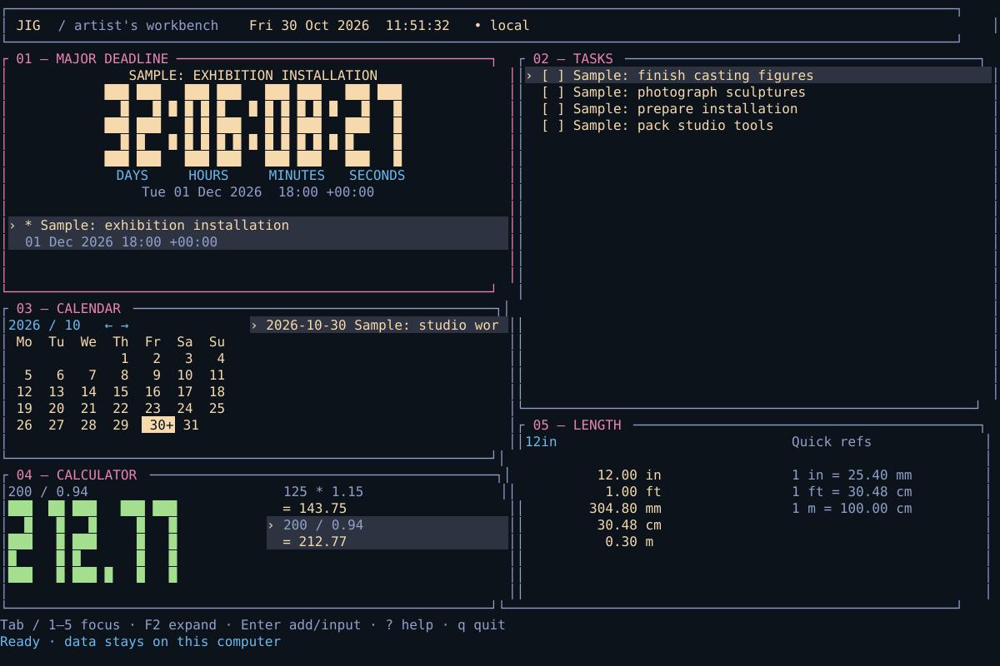

# Jig

You are a small Small Giant Psionicist.

A small, local artist's workbench in Rust:
calculator, length conversion, tasks, deadlines and calendar. The Rust CLI,
terminal dashboard and egui browser preview share the same utility logic.
The browser also includes a local STL viewer; mesh measurements are available
through the CLI using the same Rust core.
No accounts, telemetry, database, backend or background service. The CLI and
terminal run offline; the browser loads static application assets and processes
task and calculation data on your device. Weather is optional and contacts
Open-Meteo for the location you select.



The image above renders the Ratatui dashboard with clearly labelled sample data.
The browser preview combines tasks and deadlines in one checklist, with a
featured countdown, compact calendar and shared calculator/converter.
The [browser preview](https://biraz-dev.github.io/Jig/) is deployed from `main`
through GitHub Actions. Fresh visitors see clearly labelled sample data.

## Build and run on Linux

Install the stable Rust toolchain with rustup, then:

```sh
git clone https://github.com/biraz-dev/Jig.git
cd Jig
cargo build --locked --release
./target/release/jig
# Optional: install the binary in ~/.cargo/bin
cargo install --locked --path .
```

A UTF-8 terminal is recommended. Set IBM Plex Mono in your terminal preferences
if installed; terminal applications cannot select the font. The complete tiled
dashboard needs at least 100 columns × 36 rows. Smaller terminals show the focused
tool; below 32 × 10 Jig asks you to resize. F2 expands a tool at any size.

## Run the browser preview locally

Install stable Rust and the pinned Trunk build tool, then run from the repository:

```sh
rustup target add wasm32-unknown-unknown
cargo install trunk --version 0.21.14 --locked
trunk serve --public-url /
```

Open the local address printed by Trunk, normally `http://127.0.0.1:8080/`.
The preview needs JavaScript, WebAssembly and WebGL enabled. Native terminal
dependencies are excluded from the WASM build; `jig` still launches the TUI by
default.

A fresh browser opens a clearly labelled **Sample data** workbench. Open **Data**
for import/export and dataset controls. Demo edits are temporary and never
replace saved personal data. **Start empty** creates your own
workbench after confirmation; **Open local data** returns to saved personal data;
**Sample mode** returns to the demo. Personal edits save in this browser profile
under `jig.personal.v1`. **Import JSON** validates a complete Jig state file and
asks before replacing personal data; **Export JSON** downloads the current
workbench as `jig.json`. **Clear saved data** requires confirmation and returns to
temporary samples. Use export for backups and to transfer data between the
browser and CLI. Importing a file never uploads it.

The preview supports mouse interaction and normal text editing. Click an applet
to select it, or use the arrow keys while no text field is being edited. The
selected applet is highlighted. **Ctrl-M** maximizes or restores it; **Esc** leaves
an editor and returns to the dashboard. **Ctrl-Alt-4** focuses the math input;
**Ctrl-Alt-D** opens the inline **Data** controls; **Ctrl-Alt-N** opens the
start-empty confirmation; **Ctrl-Alt-O** reopens local data. Tab/Shift-Tab navigate
controls. On narrow screens the applets stack and the dashboard scrolls.

The calculator and converter use one input, result display and history. Type
`125 * 1.15` for arithmetic or `72 in mm` for a conversion (`1828.80 mm`).
`72in to mm`, `72in -> mm`, `72in → mm` and `1 1/2 in cm` also work.
Decimal places and **Copy** stay inside this instrument. Click a history result
to reuse its full precision; a converted result includes its source unit, ready
for another target, such as `1828.8 mm in`.

The browser uses one checklist. Add a task, give it an optional due date, then
star it to drive the large countdown. Starring an undated task opens its date
editor first. Completing a dated task clears its star and subdues its calendar mark;
deleting it also removes its linked date. Previously saved deadlines appear in
the same list without rewriting the saved file merely to display them.

Give a dated task a color using its inline swatch: Rose, Amber, Sage, Blue or
Lilac, or leave it neutral. The same color appears beside the task and as a
small mark on its due date only. Dates with several tasks show separate marks;
dense dates show a count for additional tasks. Completed tasks retain a subdued,
hollow mark. Colors travel with task data in JSON; older files without colors
load as neutral.

The compact calendar shows day numbers, today and due-date marks. Click or tap a
day, or use Tab then Enter/Space, to see its task names, Open/Done status and
weather details beneath the grid. The list scrolls within the panel when needed.
Calendar selection does not change
the starred task. Starring a dated task reveals its day in the calendar. Calendar
note controls and markers stay hidden; existing notes remain in saved/imported/
exported data and are still available through the native CLI and terminal.

Browser imports and saves have a 2 MiB limit. Invalid saved data is preserved and
reported. If a save fails, edits remain in memory and **Retry save** becomes
available; export them before closing the page. If another tab changes the saved
text, Jig rejects the stale write. Export your current work, then reload to open
the newer saved copy. Browser storage belongs to this browser profile and origin;
clearing site data or using another browser does not carry it over.

Completed tasks can be removed together with **Delete all completed tasks** and
an inline confirmation. Individual removal buttons use **del**.

For a production build under the repository's Pages path:

```sh
trunk build --release --public-url /Jig/
```

The **Browser preview** Actions workflow builds on pushes and pull requests,
checks WASM with Clippy, exercises the browser app, and uploads static assets and
browser test results. Deployment runs only on a push to `main`. To make the site
public, set **Settings → Pages → Build and deployment → Source → GitHub Actions**
before the first deployment. The workflow reports the published URL. See
[the browser preview notes](docs/preview.md) for implementation and deployment
details.

## Weather calendar

Weather starts disabled. Choose **Set location**, search for a town or
postcode, and select a result. You can change location, switch °F/°C, refresh or
disable it at any time. Settings stay in this browser; personal JSON exports
also carry the chosen weather preference. Changing weather in sample mode does
not save the sample checklist as personal data.

The month grid stays compact with day numbers and task marks. Select a date for forecast
high/low, rain probability and mean relative humidity beneath the grid. Dates
outside the returned forecast range have no forecast. Calendar entry controls
remain hidden and existing entries are preserved.

Weather data comes from [Open-Meteo](https://open-meteo.com/) without a key or
account, using national forecast models. It is a forecast, not a guarantee for
an individual property. The free endpoint is for non-commercial use; see its
[terms](https://open-meteo.com/en/terms) and [CC BY 4.0 licence](https://open-meteo.com/en/licence).
Only the selected location and weather variables are sent to the provider,
which also receives normal request information such as IP address. Tasks,
calculations and deadlines are not uploaded. No provider request is made until
weather is configured or you search for a location.

Forecasts are cached locally with a fetched timestamp. Automatic attempts occur
at most hourly, including after failures; refresh is also available. Cached data
is labelled stale when old or offline. Relative humidity means are calculated
from available hourly values grouped by the forecast's local date. Forecasts
cover up to 16 days; longer-range values are less certain. The forecast timezone
is shown. Weather requires a connection for fresh data; other tools work locally.

## STL viewer and clay estimates

Open a local binary or ASCII STL in the browser applet. Drag to rotate, use the
zoom controls, and choose front, side, top or isometric views. The corner X/Y/Z
gnomon follows the camera. **Ctrl-Alt-5** selects the viewer and focuses **Open
STL**; Enter opens the file picker. **Ctrl-M** maximizes or restores the applet.
The viewer uses WebGL 2 with a depth buffer, so surfaces occlude
one another correctly. Other workbench tools continue to use the existing layout.

The header's **Undo** button, or **Ctrl-Z** outside text fields, reverses the most
recent workbench or STL change. That includes calculations, tasks, dates, colors,
completion, deletion, preferences and material settings, as well as model
opening/clearing, orientation, zoom, source units, scale and shrinkage mode.
An STL drag or wheel burst is one step. Text fields keep their normal typing
undo. The single session history holds up to 20 steps within a 64 MiB budget for
data snapshots and shared geometry. It is cleared when switching datasets or
reloading, and is never saved in JSON. Restoring saved work uses the same safe
save guards as ordinary edits.

STL files do not contain units. Choose **mm**, **cm** or **in** for the source
coordinates before interpreting the numbers. Physical scale is independent of
camera zoom. The applet reports dimensions, surface area and total enclosed
volume, including cm³ (equivalent to mL) and in³. Length changes by the scale
factor, area by its square and volume by its cube. Measurements use every
accepted triangle. Models are limited to **20 MiB and 200,000 triangles**.

Small volume and area displays switch to mm³ and mm² when needed. Positive
measurements below two-decimal display precision show `<0.01` rather than zero.
Reports and scaled STL exports keep their existing precision. Maximizing the STL
applet aligns it to the top so its action row remains visible.

Surface area is the sum of triangle areas. Volume requires closed, consistently
oriented, nondegenerate faces. Holes, inconsistent edges, non-manifold edges or
mixed component winding make volume unavailable. The check does not detect
self-intersections, overlapping or nested shells; a closed mesh is not a
certificate of a valid solid. Mixed-winding cavity meshes need inspection or
repair in a modeling application. Jig does not repair geometry.

Shrinkage is an explicitly chosen **uniform linear estimate**. Estimate applies
`1 - shrinkage / 100`; compensation applies its reciprocal. For example, 6%
linear shrinkage retains 94% of each length and about 83.06% of volume.
Compensation requires about **106.38%** of the target length. These calculations
do not predict warping, cracking, anisotropy or a particular kiln's firing result.

The initial material is **Standard #104 Red with Grog**. Its
[manufacturer's page](https://www.standardclay.com/products/104-red-clay-w-grog)
publishes average shrinkage of **6% at cone 06** and **11% at cone 4**, within a
listed cone 06–4 firing range (reviewed 2026-10-30). Only those two exact points
are presets. Cone **06 differs from 6**; Jig does not infer other cones or
interpolate shrinkage between them. The source does not specify the starting
moisture stage, so the presets display that uncertainty. Save your own test-bar
values with a clay name, cone and wet-to-fired or dry-to-fired basis for a more
useful estimate of your process.

Clay profile selection and custom values travel in the existing portable JSON.
Older files remain valid. Loaded mesh bytes, filenames, camera, source units and
per-model scale remain in memory and are discarded on reload. Reopen the STL to
continue; it is never uploaded or included in workbench JSON. Scaled STL export
is a local download in the original source units; STL still carries no unit tag.

The CLI reads a model without changing it or the saved workbench:

```sh
jig stl sculpture.stl --units mm
jig stl sculpture.stl --units in --scale 150
jig stl sculpture.stl --shrinkage 6
jig stl sculpture.stl --shrinkage 11 --compensate
```

## CLI

```sh
jig calc '125 * 1.15'
jig calc '(12 + 8) * 50%'
jig calc 'ans / 2'
jig calc '72 in mm'
jig calc '1 1/2 in cm'
jig history
jig units 12in mm
jig units '1 1/2in' cm
jig units 304.8mm ft
jig tasks
jig tasks add 'Photograph sculptures'
jig tasks edit 1 'Photograph new sculptures'
jig tasks due 1 '2026-12-01T18:00:00-05:00'
jig tasks star 1
jig tasks due 1
jig tasks done 1
jig tasks move 1 2
jig tasks delete 1
jig tasks clear-completed
jig deadline add 'Exhibition opening' '2026-12-01T18:00:00+01:00'
jig deadline list
jig deadline feature 2
jig deadline countdown
jig deadline edit 2 'Opening' '2026-12-02T18:00:00+01:00'
jig deadline delete 2
jig calendar
jig calendar --year 2027 --month 1
jig calendar add 2026-12-01 'Studio visit'
jig calendar list
jig calendar edit 3 2026-12-02 'Workshop'
jig calendar delete 3
jig precision 3
jig --state /path/to/portable/jig.json
jig --help
```

IDs are printed when adding items and listed by CLI commands. They are shared
across tasks, deadlines and calendar notes; use the actual returned IDs.
`tasks done` toggles completion. Task positions are 1-based. Errors go to stderr
with a nonzero exit status. `deadline countdown` prints one snapshot; the TUI
refreshes the countdown every second.

`tasks due ID AT` assigns a timezone-qualified due date; omit `AT` to clear it.
`tasks star ID` features a dated, unfinished task. Assigning a date alone does
not star it. Existing `deadline` commands remain compatible with portable files.

Arithmetic syntax: `+ - * /`, decimals, unary signs, parentheses, postfix `%`,
and `ans` (the last result). Percent always divides its operand by 100:
`100 + 10%` is `100.10`; use `100 * (1 + 10%)` for a 10% increase. No implicit
multiplication, functions, exponent notation, variables or executable code.
Lengths accept decimal, fractional and mixed-fraction quantities with an explicit
source unit: `in`, `ft`, `mm`, `cm`, `m`. All directions work. Display defaults to
two decimals; calculations and stored values retain f64 precision.

The browser input, terminal calculator and `jig calc` recognize both arithmetic
and simple conversions. A conversion needs a quantity, source unit and target
unit, with optional `to` or an arrow before the target. Inch/foot aliases are
accepted. `ans` always means the numeric value of the last answer: use `ans / 2`
for arithmetic or `ans in mm` to supply an explicit source unit. This is not
dimensional algebra; expressions combining measurements are outside this syntax.
History stores the target unit with conversion results. Existing state files
without unit metadata continue to work. The separate `jig units` command remains
a read-only conversion shortcut.

## Terminal dashboard keys

| Key | Action |
| --- | --- |
| Tab / Shift-Tab, 1–5 | Focus: deadline, tasks, calendar, calculator, length |
| F2 / Esc | Expand / return to tiles |
| Enter, i, a | Input a calculation/length or add an item |
| e | Edit selected task, deadline or calendar note |
| ↑ / ↓, j / k | Select items; scroll calculator history |
| r in calculator | Reuse selected result without rounding |
| Space in tasks | Toggle completion |
| J / K in tasks | Move task down / up |
| f in deadlines | Feature selected deadline |
| d / Delete | Delete selected task, deadline or calendar note |
| ← / → in calendar | Previous / next month |
| t in calendar | Return to current month |
| ? | Keyboard help |
| q / Ctrl-C | Save and quit |

Input appears inside the focused panel. Enter advances to the next field and
submits the last field; Tab changes fields; Ctrl-U clears a field; Backspace
removes a character; Esc cancels. Editing uses append/backspace, not a full text
editor. A deadline needs a timezone-qualified RFC3339 timestamp. Local dates and
deadline times display in the computer's timezone. Calendar `*` marks deadlines,
`+` marks dated notes, and today is highlighted. Notes below the month can be
selected and edited independently of the displayed month.

## Portable state

Default: `$XDG_DATA_HOME/jig/jig.json`, or `~/.local/share/jig/jig.json`.
`--state PATH` overrides it for every command. Copy that one file to another
computer and open it with `--state`; no migration service or database is needed.
State includes preferences, complete calculator history, task order, deadlines,
calendar notes and featured deadline ID. New terminal installations start empty;
the converter initially displays 12 inches as an instrument example. Browser demo
samples are generated in code and kept separate from saved personal state.

Dated tasks carry an optional link to a deadline record. Old task records without
that field remain valid. Task and linked deadline edits stay synchronized;
completing a task clears its featured countdown, and removing a task or its date
cleans up the link. Older standalone deadlines remain usable in the unified
browser list and through the existing CLI commands.

JSON is deliberately simpler than Markdown front matter: one established serde
parser, an explicit format version, and no ambiguity between prose and structured
data. It is human-readable and editable while Jig is stopped. No personal state
is committed; the public preview contains only synthetic samples. A terminal or
CLI save on each successful mutation uses a same-directory temporary file, file sync, atomic rename and directory sync on Linux. Invalid or
unsupported state produces an error and is never silently reset. Files created
on Unix use mode 0600.

Only one Jig process can open a given file at once. After a crash, check that no
Jig process is running, then remove the lock formed by appending `.lock` to the
entire state filename, such as `jig.json.lock` or `portable.state.lock`. A leftover
temporary file similarly appends `.tmp`, such as `portable.state.tmp`. It blocks
saves rather than overwriting possibly recoverable data: inspect it, copy it
aside or recover it, then remove it. Keep your own backups; there is no automatic
backup retention. A save failure rolls a TUI mutation back
and displays an error. Quit retries the save. Preferences are also saved on quit.

## Development

Single crate: `src/lib.rs` exposes portable logic; `src/main.rs`, `storage.rs`
and `tui.rs` adapt it for Linux files, commands and the terminal. `src/web.rs`
implements the egui browser dashboard, and `src/browser_storage.rs` plus
`web/bridge.js` adapt browser-local storage and file import/export. Terminal and
web dependencies are optional and target-specific. No filesystem, DOM, terminal,
CLI or network API is used by the core modules. Chrono supplies calendar
and timezone arithmetic; serde supplies portable serialization. Arithmetic is a
small bounded parser for the deliberately limited grammar.

```sh
cargo fmt --check
cargo clippy --locked --all-targets -- -D warnings
cargo test --locked
cargo build --locked
python3 tests/terminal_smoke.py
cargo clippy --locked --target wasm32-unknown-unknown --no-default-features --features web --bin jig-web -- -D warnings
trunk build --release --public-url /Jig/
```

Tests cover arithmetic errors and precedence, percentages, precise result reuse,
conversion round trips and fractions, checklist changes, deadlines/timezones,
leap years, labelled synthetic samples, state serialization, safe saves, locking,
CLI restart persistence, rejected intermediate arithmetic overflow, and imported
history containing terminal controls.
GitHub Actions runs the same checks, a Linux PTY smoke check, and a release build.
The PTY check verifies idle countdown redraws, keyboard input, resizing, restart
persistence and terminal restoration. CI publishes the Linux binary as an artifact.

## Limitations and next steps

The native dashboard is keyboard-only. The browser supports mouse and keyboard,
but the egui canvas currently has limited screen-reader accessibility. Browser
background tabs may throttle the otherwise one-second countdown refresh. Browser
storage can be cleared or unavailable; JSON export is the portable backup.
Browser state is capped at 2 MiB; CLI history is intentionally unbounded.

Arithmetic uses f64 rather than exact decimal/rational values. Undo is currently
available in the browser; the terminal has no undo. There are no recurring
deadlines, timezone database selection, external calendar sync, scientific
calculator or automatic backup retention. The native terminal editor
uses append/backspace editing. No native graphical application is included.
The preview bundles monospace fonts and makes no remote font requests.
Optional weather sends the selected location to Open-Meteo as described above. It has no service worker: reopening it offline depends on the browser's
asset cache; use the native binary for dependable offline launch.

The layout follows the supplied concept with compact instruments and optional weather;
priorities and additional measurement modes are outside this milestone.
Next, validate the browser preview on real devices, improve canvas accessibility
and narrow layouts, and address concrete feedback before adding tools. The
[Actions page](https://github.com/biraz-dev/Jig/actions) shows build progress;
[preview notes](docs/preview.md) describe Pages deployment and follow-up work.
