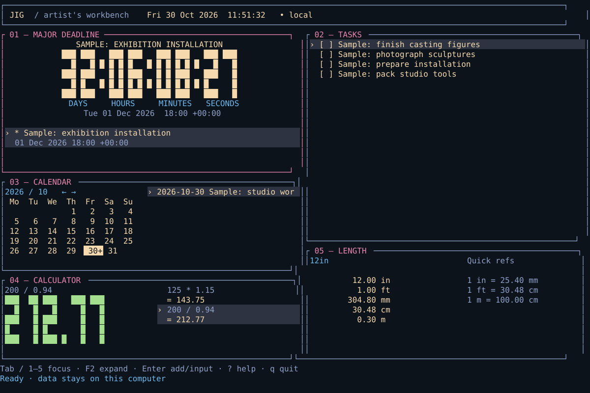

# Jig

Jig is a local place to work things out, written in Rust. The browser starts in
**Tasks** and remembers your workspace. **Tasks**, **Notes**, **Draft**, **Sheets**
and **Charts** are the main views. The header groups About, Data, Tasks, Notes,
Draft, Sheets, Charts, Settings and Help on the left, with the calculator at the
far right. Tasks, Gantt dates, notes, Draft, sheets, charts and preferences use the same
portable document. The native CLI and Ratatui terminal interface share the Rust
core; running `jig` still opens the terminal dashboard. Existing native geometry
commands and saved legacy data remain compatible.

No accounts, telemetry or backend. Files are processed on your device.
The [browser app](https://biraz.dev/Jig/) starts with your saved data or an empty
personal document. Personal documents are never published by the Pages build.

For everyday work, capture text in **Notes** or **Draft**, turn useful pieces into
**Tasks**, and add dates when they matter. Use **Sheets** to work out numbers and
**Charts** to inspect the results. **Data → Export JSON** and **Save Jig backup
(.ods)** keep a portable copy of the whole document; CSV and PDF share sheet
content. The [1.0 review](docs/1.0-review.md) records the scope and stabilization
decisions.

## Spreadsheet

The grid starts in warm dark Ember, with familiar top menus, a formula bar, a formatting toolbar and
named sheet tabs. Click a cell and type, double-click or press **F2** to edit;
**Enter** commits, **Esc** cancels. Drag or Shift-click to select a range.
Use the address field to jump to `B12` or select `A1:D20`.

- Numbers, percentages, booleans, ISO dates (`2026-11-11`) and text. Prefix an
  apostrophe to keep text such as `'0012` literal.
- Arithmetic, parentheses, comparisons, powers and percentages:
  `=(A1+B2)*1.15`, `=A1^2`, `=IF(B2>100,"Review","OK")`.
- Relative and anchored references (`A1`, `$A$1`, `A$1`, `$A1`), ranges and named
  sheet references such as `='Clay tests'!B2`.
- `SUM`, `AVERAGE`, `MIN`, `MAX`, `COUNT`, `IF`, `ABS`, `ROUND`, `CONVERT`, `DATE`, `TODAY`,
  `DAY`, `MONTH`, `YEAR`, `TRUE` and `FALSE`. Dates can be subtracted for durations
  or offset by a number of days. `TODAY()` follows the local calendar day.
- Mono, Sans and Serif fonts; sizes 9–32; bold, italic, underline, strikeout,
  left/center/right alignment, text/fill colors and borders. Auto alignment keeps
  numbers on the right and text on the left. General/Number/Percent/USD/Date
  formats are available; USD is the only currency offered for new formatting.
  Existing foreign-currency formats in imported documents remain intact.
  Display precision never rounds saved inputs.
- Insert/delete rows and columns, merge/unmerge selected cells, add/rename/delete
  tabs. Structural changes update references. Merging rejects ranges that would
  hide existing cell content.
- Double-click a sheet tab to rename it. The **+ / -** buttons beside the tabs
  add a sheet or delete the active one; deletion uses inline confirmation and can
  be undone. The final sheet cannot be deleted.
- Right-click a row number or column letter (or touch and hold) to insert above/
  below or left/right, or delete. Shift-click selects a span of headers and the
  menu acts on the whole span. **Shift-F10** opens the menu for selected headers;
  the Insert menu also provides keyboard and touch access.
- **Borders** offers no/all/outside/inner borders, horizontal or vertical lines,
  and individual top/bottom/left/right edges. Horizontal and vertical presets
  include the corresponding outside edges; individual edges add to existing
  borders. Merged cells retain a single perimeter. Alignment, strike and borders
  survive JSON and standard ODS round trips and appear in PDF exports.
- Alignment uses familiar line icons. The border icon opens a compact grid of
  previews: solid lines show the affected edges and dashed guides show the
  remaining grid. Controls have named tooltips and keyboard focus feedback;
  Tab and Space/Enter operate the same controls from the keyboard.
- Copy and paste rectangular cells. Copies made inside Jig translate relative
  formula references when pasted elsewhere; pasted tab-separated text fills a
  block. Clear removes contents while retaining formatting. **Undo** covers sheet
  changes alongside existing task, note and calculator changes.

The grid paints visible cells and caches calculated values until edits or a local
calendar-day change. Each sheet has **1,000 rows × 52 columns (A–AZ)**; a workbook
has up to **16 sheets**, **20,000 populated/styled cells** and **1 MiB of cell input**.
Formula work is bounded. Errors such as `#REF!`, `#DIV/0!`, circular references and
unsupported functions remain visible. A number or date too wide for its cell
shows `####`; select it to inspect the full value and saved input.

### Conversion formulas

Put a numeric centimeter measurement in `A1`, then use
`=CONVERT(A1,"cm","in")` in another cell for inches. Changing `A1` recalculates
the conversion and any formulas using it. Unit names can also come from cells,
as in `=CONVERT(A1,B1,C1)` when `B1` contains `cm` and `C1` contains `in`.

Supported lengths are `mm`, `cm`, `m`, `in` and `ft`, including their spelled-out
aliases. Add `2` for area or `3` for volume (`cm2`, `in2`, `cm3`, `in3`). Units
must describe the same dimension. This converts physical measurements; costs
come from ordinary arithmetic using your own rate.

| Calculation | Formula |
| --- | --- |
| Centimeters to inches | `=CONVERT(A1,"cm","in")` |
| Area from two centimeter dimensions, in square inches | `=CONVERT(A1*B1,"cm2","in2")` |
| Volume from three centimeter dimensions, in cubic inches | `=CONVERT(A1*B1*C1,"cm3","in3")` |
| Cost at a per-inch rate stored in `D1` | `=CONVERT(A1,"cm","in")*D1` |

Conversions retain calculation precision; the usual display precision controls
what is shown. Unknown units, incompatible dimensions and invalid arguments
produce `#VALUE!`; an overflowing result produces `#NUM!`. ODS and JSON retain
the formula and its references.

### Documents, CSV and printing

**File → Save Jig backup (.ods)** downloads `jig.ods`, the main portable document. Standard
OpenDocument cells carry formulas, typed values, formats, merges and sheet names.
A Jig metadata entry also retains the complete state: tasks, linked deadlines,
colors, notes, Draft, charts, cell-linked controls, preferences, calendar notes
and calculator history. Keep this whole-document scope in mind when sharing an
ODS file.

**Open ODS** shows an import summary before replacing saved data. An ordinary ODS
from another editor replaces the workbook and keeps your existing Jig tools.
When an exported Jig ODS is edited externally, its visible spreadsheet changes
are imported while its embedded Jig task, Draft and history data is retained.
Jig supports its documented formula subset; it does not promise full Excel or LibreOffice
compatibility. ODS charts are exported as SVG snapshots; Jig chart and control
specifications remain editable in Jig through the embedded metadata. They are
not native editable ODS chart objects or spreadsheet form controls. Foreign
native ODS chart objects are not imported.
Browser ODS input is limited to 10 MiB; the core bounds expanded ZIP/XML content.

**Import CSV** fills cells starting at the selection. **Export CSV values** writes
one sheet's evaluated values at stored precision; formulas, styles, other sheets
and tasks require ODS or a Jig JSON backup. CSV input is UTF-8 and limited to 2 MiB.

**File → Export PDF** prints the active sheet's used area, or the selected range
when more than one cell is selected, followed by its relevant charts as vector
pages. A4 landscape pages repeat row/column labels and include page numbers.
Fonts are embedded with Unicode mappings; number/date/currency formats, fills,
borders and merges are retained. Long cell text clips at its cell boundary;
oversized numeric values show `####`. The export is capped at 200 pages.

### Charts and cell-linked controls

**Charts**, beside **Sheets**, holds pie, line, bar and Gantt charts, plus small
controls linked to workbook cells. In Sheets, select a range and choose
**Insert → Send selection to Charts…** to prefill the source. In Charts, **Create**
opens a chart or control draft; choose its sheet and range or cell, then
**Create chart** or **Add control**. **Cancel** or Esc discards the open draft.
Sheets also retains its direct Insert chart actions and **View → Charts**.

Pie, line and bar charts read labels and numeric values from the first two
columns; Gantt charts read labels, start dates and due dates from three columns.
An optional first header row is recognized. Sources stay linked to the original
cells, so edits recalculate the charts. Charts can be renamed or removed.

**Number input** writes a value with Apply or Enter. **Slider** writes a value
within its configured min/max/step on release. **Calculated result** displays a
cell's current value, including formula results, without writing to it. Input
controls protect formula cells. **Edit layout** reveals control editing,
up/down ordering and deletion; **Save control** commits an edit, while Cancel
discards it. Committed chart, control and input-value changes use the shared
Undo/Redo history. JSON and Jig ODS retain their definitions and cell links.

**Tasks** opens the existing checklist and calendar/timeline. Add a task, give it
an optional due date, and star it to drive the featured countdown in Tasks.
**Gantt from Jig tasks** reads these same records directly, including their
colors and completion status. Editing a task updates its live chart; there is no
second copy of the task to maintain.

### Sheet keys

| Key | Action |
| --- | --- |
| Arrows / Shift-Arrows | Move between cells / extend selection |
| Tab / Shift-Tab | Next / previous cell |
| Enter / F2 | Edit the selected cell |
| Ctrl-G | Go to a cell or range |
| Ctrl-Home / Ctrl-End | First cell / end of used area |
| Ctrl-C / Ctrl-V | Copy / paste cells |
| Shift-F10 on selected row/column headers | Insert/delete context menu |
| Delete / Backspace | Clear selected contents |
| Shift-F11 | Add a sheet |
| Alt-PageUp / Alt-PageDown | Previous / next sheet |
| Ctrl-S / Ctrl-O / Ctrl-P | Download ODS / open ODS / export PDF |
| Ctrl-Z / Ctrl-Shift-Z outside text fields | Undo / Redo a Jig change |
| Ctrl-Alt-2 | Tasks |
| Ctrl-Alt-W | Switch Sheet / Tasks |
| Ctrl-Alt-4 | Open the calculator popover |

Text fields retain their normal editing shortcuts. File and Edit menus also
provide pointer/touch access to these actions.

### Import statement PDFs and images

**File → Import PDF or image…** selects local PDFs, PNGs or JPEGs for review.
This supports gathering statement and transaction information into cells for
preparation. Review extracted rows, correct their contents and confirm the
destination before inserting them. Text PDFs can be read directly; scanned PDFs
and screenshots need the optional OCR step.

Document text extraction runs locally. OCR also processes pages in the browser;
its recognition assets must be loaded before use. File contents are not sent to
an OCR service. The source PDFs/images remain session-only; confirmed cell values
are saved with the workbook. The browser file picker accepts up to 20 documents,
10 MiB each and 50 MiB total. Verify dates, signs, decimal places and totals
against the originals. Jig does not classify accounts or calculate/file taxes.
Explicit foreign-currency markers in columns mapped to USD are flagged rather
than relabelled as dollars; review can retain those original values as text.

## Build and run on Linux

Install stable Rust with rustup, then:

```sh
git clone https://github.com/biraz-dev/Jig.git
cd Jig
cargo build --locked --release
./target/release/jig
cargo install --locked --path .  # optional: installs in ~/.cargo/bin
```

This runs the native terminal dashboard and CLI. The graphical Sheet workspace
is currently the browser application; there is no native graphical binary yet.
A UTF-8 terminal is recommended. Set IBM Plex Mono in your terminal preferences
if installed. Full terminal tiles need 100 columns × 36 rows; smaller sizes show
the focused tool, and below 32 × 10 Jig asks you to resize. F2 expands a tool.

### Run the browser locally

```sh
rustup target add wasm32-unknown-unknown
cargo install trunk --version 0.21.14 --locked
python3 scripts/fetch_ocr_assets.py
trunk serve --public-url /
```

Open the address printed by Trunk, normally `http://127.0.0.1:8080/`. The app needs
JavaScript, WebAssembly and WebGL enabled. Terminal dependencies are excluded from
the WASM build. Fonts are bundled; Jig makes no remote font requests.

The OCR build step downloads pinned official engine packages and English model
data, verifies SHA-256 hashes, and prepares the optional self-hosted assets.
Generated engines are not stored in Git. After the first fetch, builds can use
the cached files offline; `python3 scripts/fetch_ocr_assets.py --verify-only`
checks their completeness without making network requests. Only static engine
assets are downloaded at build time; financial documents are never uploaded.

For a Pages build, run the same asset step before
`trunk build --release --public-url /Jig/`. The **Browser
preview** Actions workflow builds on pushes and pull requests and deploys pushes
to `main`. Repository **Settings → Pages → Source** must be **GitHub Actions**.
See [preview notes](docs/preview.md) and [Actions](https://github.com/biraz-dev/Jig/actions).

## Local browser data

New visitors start with an empty personal document in Tasks. Existing saved work
opens automatically; your workspace choice is remembered. Older Workbench
preferences open Tasks. **Data → Start empty**
replaces personal data after confirmation. **Open local data** reopens saved work.
There is no sample mode; older `?sample=1` links open your normal document.

Personal edits autosave in this browser profile under `jig.personal.v1`.
**Save Jig backup (.ods)** is the portable document download; **Export JSON** is a full Jig
backup compatible with the native CLI. **Import JSON** validates the complete
state and asks before replacement. Older files without Draft, spreadsheets,
task colors or start dates still load. **Clear saved data** also requires confirmation and
returns to an empty document.

A normal refresh or application update keeps personal data. Press **Enter** to
commit a spreadsheet cell before leaving. Personal/local badges are removed.
Use **Start empty** only when you intend to begin with an empty dataset.

Unfinished note/task text and start/due date edits are backed up separately in
this tab's session storage and recovered after a refresh. Save a note with **Save/Ctrl-Enter**, or
add a task with **Enter**, to commit it to the document. Session drafts are a
refresh safeguard; JSON/ODS downloads remain the portable backups.

Browser JSON saves/imports have a 2 MiB limit. Invalid saved data is preserved and
reported. Failed saves leave edits in memory with **Retry save** available; export
before closing the page. A stale tab cannot overwrite a newer save. Storage is
specific to this profile and origin, so keep portable file backups. Opened
PDF/image source bytes are session-only and are not embedded in saved state.

## Settings and backups

Open **Settings** between **Charts** and **Help**, or use **Ctrl+,**. It opens a
full main view; **Done** returns to the workspace. **Appearance** offers **Ember**
(Jig's original warm dark look), **Paper**, neutral dark **Graphite**, **Nord**,
**Dracula**, **Catppuccin** (Mocha), **Gruvbox** (Dark), **Tokyo Night** (Default),
**Dark** (neutral near-black), **Rosé Pine** (Default), and **Apprentice** (Default).
The community presets follow their [Terminalcolors variants](docs/preview.md#application-settings).
**System** follows the browser's light/dark preference.

Expand **Customize colors** at the end of Settings to edit background, surface,
text and accent with `#RRGGBB` values or a color picker. Choose **Custom** to use
your saved palette, or **Customize this theme** to start from the current preset.
Selecting a preset keeps your custom colors for later. Optional system accent
uses CSS `AccentColor` when the browser exposes it and otherwise keeps your
chosen accent. Manual controls remain available; turn off system accent to use
your chosen accent. The browser cannot read a full desktop or GTK theme.

Themes apply across browser workspaces, including Draft and chart backgrounds,
text and controls. Task/list colors, chart series colors and explicit cell
formatting remain document data. Printed PDF pages keep a white background.
Theme choices and customization work locally without a network request.

**About** starts the header; **Help** follows **Settings**, and the calculator
sits at the far right. About and Help open in the main panel without changing your
document.
**Done** or **Esc** returns to your work.
Help covers tasks, Gantt dates, notes, Draft, sheets/charts, calculations, shortcuts and backups.

Settings are saved separately under `jig.settings.v1`, so changing appearance,
shortcuts or backup options does not edit the task document. **Export settings**
downloads `jig-settings.json`; **Import settings** accepts up to 32 KiB, validates
its version-2 format and shows a review before applying it. Version-1 settings,
including files without an explicit version, migrate with shortcuts, Undo levels
and backup preferences intact: old Graphite becomes Ember, and Light becomes
Paper, preserving their appearance. Invalid or conflicting settings
leave the current settings and document intact. Task JSON and ODS remain the
portable document formats; copy settings separately when moving computers.

The thirteen application shortcuts can be changed, reset or unassigned. Click a
binding and press the combination; Esc cancels capture. Conflicting bindings,
ordinary typing keys, and reserved browser/text commands are rejected. The
Settings cheatsheet shows current application bindings and the fixed contextual
keys for text, sheets, notes and calendar controls.

| Application action | Default |
| --- | --- |
| Sheet / Tasks | Ctrl-Alt-W |
| Tasks | Ctrl-Alt-2 |
| Notes | Ctrl-Alt-N |
| Calculator | Ctrl-Alt-4 |
| Calendar / Timeline | Ctrl-Alt-T |
| Data | Ctrl-Alt-D |
| Settings | Ctrl+, |
| Undo | Ctrl-Z |
| Redo | Ctrl-Shift-Z |
| Maximize panel | Ctrl-M |
| Rename list / expand panel | F2 |
| Open saved local data | Ctrl-Alt-O |

Other text fields keep local editing shortcuts; Draft uses the shared history.
The history limit is configurable
from **0–100 combined Undo/Redo steps**, with **20** by default and a shared
**64 MiB** cap. Release the slider or finish numeric entry to apply it. Lowering
the limit discards the furthest steps; increasing it cannot recover discarded
history. Zero disables application history, including Draft; other text editors
retain theirs.
The application Undo/Redo journal lasts for the session and is not included in
document backups; calculator history remains part of the saved document.

Under **Files and backups**, supported Chromium browsers can **Choose folder**
for JSON backups. Folder writes require your explicit browser permission; use
**Reconnect folder** if access needs renewing. Only the folder handle is kept in
browser IndexedDB as permission metadata. Tasks, notes and sheets continue to
use the portable JSON document; settings exports do not contain folder access.

**Back up now** writes successfully saved personal data to a new timestamped,
unique filename without replacing an earlier backup. Optional **Automatic
folder backups** queue no sooner than five minutes after enabling, opening valid
saved personal data, or eligible saved changes, and run while Jig is open.
Stale/corrupt storage and failed saves do not produce automatic folder backups.
Dataset resets cancel pending backup work. There is no automatic backup retention
or cleanup.

**Download backup** provides a JSON recovery copy of current personal work,
including edits left in memory after a failed save. It is also the fallback on
browsers without folder access. **Restore backup** opens the existing JSON
import review and requires confirmation. The chosen folder applies to backups;
CSV, ODS and PDF exports still use the browser's download location.

If a folder backup fails, a recovery notice stays visible in the workspace and
at the top of Settings, including after refresh. **Retry backup** writes the
current document to a new file once its changes have saved. **Reconnect folder**
requests access when needed; **Download backup** keeps a recovery copy when
folder writing is unavailable. Downloading does not repair the folder connection.
Successful folder writes clear the notice. Replacing or clearing the document,
or disconnecting its backup folder, discards the previous recovery notice and
cancels pending writes. The retry controls are explicit; normal automatic
backups still follow their existing schedule after saved changes or reopening.

## Tasks, calendar and timeline

Task lists appear as horizontal tabs, with a maximum of five. Click a tab to show
one list; **Shift-click** tabs to combine them. Combined views use subtly different
row shades while retaining each task's deadline color. **Multi** enables the same
selection on touchscreens. **+** adds a list, double-clicking its name (or **F2**
on a focused tab) renames it. Click **−** to ask to remove the active list, then
click **−** again or **Remove** to confirm. **Cancel** or **Esc** dismisses the
confirmation. The +/− controls sit beside the tabs. Removing a list moves its
tasks into a remaining list; the last list cannot be removed.
Tasks, their dates and the featured countdown are preserved.

New tasks go into the active list. The task editor can move an existing task to
another list. Reorder and clear-completed actions apply to the visible lists.
**Move all completed** opens a destination-list picker for the selected lists.
Choose a list to move their completed tasks in one action; dates, colors, details
and completion status stay with each task. **Undo** restores their original lists.
The move saves automatically and is included in JSON and Jig ODS backups.
Sort places open tasks with the earliest due dates first, keeps undated tasks
in their current relative order below them, and moves completed tasks to the
bottom. Matching due dates retain their order. Sorting affects the selected
lists, updates the same Gantt order, survives refresh and can be undone once;
you can still reorder manually afterward. Lists and membership are included in
JSON and ODS saves; older files open as one **Tasks** list. Selecting tabs or
calendar dates never replaces the starred task.

Drag the grip at the start of a task to reorder it. An insertion line previews
the destination; release commits one Undo step and updates the Gantt row order.
List membership, dates, colors and completion stay with the task. The existing
up/down buttons remain available from the keyboard. Mouse and touch use the same
grip, leaving the task text available for swipe scrolling.

Drag the divider between tasks and the timeline to adjust their widths. Its
grip shows horizontal resize arrows; focus it and use **Left/Right** for small
adjustments or **Shift-Left/Right** for larger ones. Double-click to reset the
default split. A finished resize is one Undo step, and the preferred width is
saved with your local preferences and portable backups. Narrow screens stack
the panels without replacing your saved split.

In wide layouts, drag the horizontal divider's up/down grip to share space
between Tasks/Gantt and Notes. Focus it and use **Up/Down**, or **Shift-Up/Down**
for larger steps. Release saves one undoable resize; **Esc** cancels the preview.
Double-click restores the adaptive height. Its position travels with your local
preferences and backups; narrow screens retain their stacked layout.

The separate Workbench tab, header title and tagline are removed. The selected
task or calendar/timeline panel can be maximized/restored with **Ctrl-M**.
Arrows outside text fields move panel selection; **Esc** leaves an editor or
closes a popup. Narrow screens stack the panels and scroll. **Ctrl-Alt-D** opens
Data controls.

The calculator icon at the far right, or **Ctrl-Alt-4** by default, opens a compact
popover without leaving the current workspace. Its input accepts `125 * 1.15`,
`72 in mm`, `72in to mm` and `1 1/2 in cm`. Decimal places and Copy stay inside;
click a history result to reuse its full precision and conversion unit. Click
outside or press Esc to close it.

The view buttons are **Calendar**, **Dates** and **Timeline**. Calendar shows a
classic Monday-first month grid. Previous/next arrows browse months, and Today
returns to the current day.

Choose **Dates** for a continuous strip of days with month boundaries. Widen
the panel to see more dates, drag or use horizontal/Shift-wheel scrolling to pan, and
use **+ / −**, Ctrl-wheel or a pinch to zoom. Today returns to the current day.
With the strip focused, Left/Right select a day, Page Up/Down move a page, Home
returns to today and +/− zoom. These view changes do not move any deadlines.

Calendar and Dates share the selected date, due-date colors, task details and
weather. Both views can fill a task's Start or Due date; browsing months and
selecting dates leave the starred countdown unchanged.

Dated tasks have optional Rose, Amber, Sage, Blue or Lilac colors. Their due day
gets the same mark in the calendar; several tasks show separate marks and dense
dates add a count. Completed tasks keep subdued, hollow marks. Click/tap a date,
or select a day with the focused strip's arrow keys, to see task names, Open/Done
status and weather. Selecting a date leaves the starred countdown alone. Completing a task clears
its star; deleting a task also removes its linked deadline. **del** removes one
task; **Delete all completed tasks** asks before clearing completed work.
Calendar note controls are hidden in the browser, while saved notes and native
CLI/terminal note functions remain available.

Choose **Timeline** beside Dates, or **Ctrl-Alt-T**, for the task Gantt view.
Week/Month, arrows and Today change the visible range. Tasks with start and due
dates are bars; due-only tasks are diamonds. Completed rows are labelled Done.
Drag the divider between task titles and the date grid to make room for longer
names. Its width is saved; double-click resets it. The focused divider also
accepts Left/Right and Shift-Left/Right, like the outer panel divider.

Drag either end of a task bar to change its start or due day. The chart previews
the range while dragging and saves on release as one Undo step. The opposite
date stays fixed, and crossing it stops at a one-day range. Existing clock times,
task colors, completion and the starred countdown are preserved. Focus an end
handle and use Left/Right to change one day, or Shift-Left/Right for a week;
Esc cancels a drag. A clipped end must be brought into view before resizing it.
Deadline-only diamonds still use the date editor.

Select a row to edit dates inline. A calendar icon beside each start/due field
opens a month picker with local 24-hour HH:MM time. **Use date** updates the draft;
**Save date** commits the schedule and **Cancel** leaves it unchanged. You can
also type `YYYY-MM-DD`, local `YYYY-MM-DD HH:MM`, or a timezone-qualified RFC3339
timestamp. Date-only edits retain an existing time; new starts use midnight and
new deadlines use 09:00 local time. Unchanged displayed times retain their exact
stored precision, and nonexistent local times are rejected. Removing a due date
clears its start. The starred task stays independent of calendar/timeline
selection. Legacy standalone deadlines remain usable.

You can also pick on the Calendar grid or Dates strip: keep the date editor
open, choose Calendar or Dates, then click or focus Start or Due. The calendar
labels the active field;
selecting a day fills that draft and retains its time. **Save date** commits the
range. **Done picking** or Esc exits picking without discarding the draft.
Panning and zooming do not assign dates or change the featured countdown.

**Ctrl-Z** and **Ctrl-Shift-Z** are the default document Undo/Redo shortcuts and
also apply inside Draft. A new committed edit clears Redo; a no-op keeps
it. The configurable session journal shares a 64 MiB budget and is cleared when
switching datasets or reloading; it is not saved in documents. There are no
Undo/Redo buttons in the header. Other text fields keep their normal local
Undo/Redo; Draft uses the shared document history. See
[Settings and backups](#settings-and-backups) for the history limit and current
shortcut bindings.

## Notes

Open **Notes** in the top bar, or press **Ctrl-Alt-N**. The same board also appears
below Tasks/Gantt. Notes are plain text with no title field: up to 81 cards, with
at most nine columns on wide screens and fewer columns on smaller screens.

Choose **Add note**, type or paste, and use **Save**, **Ctrl-Enter** or **Ctrl-S**.
Enter adds a new line. **Cancel**, **Escape**, clicking outside the editing card,
or leaving its workspace discards the draft and keeps the saved note unchanged.
Opening another note or choosing Add note also discards the previous draft.
Click a card's text to edit it. **copy**
copies its complete text, including lines hidden by the compact card preview.
Pinned notes stay first. Drag a card's handle to reorder it, or focus the handle
and use **Alt-arrows**; pinned and unpinned notes reorder within their groups.
**×** deletes a card. Saved edits, pinning, moving and deletion use the shared Undo;
cancelling a draft leaves Undo and Redo unchanged.

Choose **task** on a note to pick a task list and convert it. Its first nonblank
line becomes the checklist name, and the full original text stays with the task.
The task editor's **To note** action converts it back. Conversion moves the
existing record. A scheduled task's dates, color and completion are retained
while it is a note, with no active calendar or Gantt entry; converting it back
restores them. An existing featured task is never replaced by a restored one.

On the **Tasks** page, drag a note's **↕** handle into the task list above it.
Dropping on a task row uses that row's list; dropping in blank space uses the
active list. The highlighted destination names the list, and the insertion line
shows the new task's position. This moves the record with its complete text and
retained schedule, as with the **task** button. Reordering and conversion save
only when released on a valid target and can be undone once; **Escape** or
releasing outside a target cancels. Screen edges scroll during a drag so distant
rows can be reached. Use the handle on touchscreens to keep body swipes available
for scrolling.

Notes are saved locally with the document and included in JSON/ODS backups.
Older documents open with an empty board. Text is limited to 16 KiB per note;
the existing browser document size limit still applies.

## Draft

Open **Draft** next to **Notes** for one continuous text holding zone. Paste
information, tidy it up, and select text to change its size (8–72), bold, italic,
underline, link, paragraph alignment, bullets or numbered list. Links support
HTTP, HTTPS and email addresses with `mailto:`.

**Copy** preserves formatting where the browser supports rich clipboard output,
with a plain-text fallback. **To note** and **To task** copy the selection, or the
whole Draft when nothing is selected, as plain text. The original stays in Draft.
A task uses the first nonblank line as its name and keeps the full text in its
details. These transfers use the existing 16 KiB note/task-text limit.

Edits save locally as you type. **Ctrl/Cmd-Z** and **Ctrl/Cmd-Shift-Z** use Jig's
shared Undo/Redo; continuous typing forms one history step. **Esc** returns
keyboard focus to the main app without discarding text. Pending edits have a
tab-local refresh recovery copy; portable backups remain JSON and Jig ODS.
Draft is limited to 512 KiB of text within the browser's 2 MiB document limit.

JSON and Jig ODS retain Draft formatting; older documents open an empty Draft.
ODS includes the complete Draft in Jig metadata, rather than exposing it as a
word-processing document or spreadsheet cells.

## Weather calendar

Weather starts disabled. Choose **Set location** above the calendar/timeline, search
for a town or postcode, and select a result. You can change location, switch
°F/°C, refresh or disable it at any time. Settings stay in this browser; personal JSON exports
also carry the chosen weather preference.

The date strip stays compact with day numbers and task marks. The compact weather
strip above the calendar/timeline shows today's forecast high/low, rain probability
and mean relative humidity. Select a calendar day to show that date instead.
Location settings open in the same header; no weather footer uses space beneath
the chart. The timeline uses the remaining panel height as tasks grow, and its
title divider stops at the last visible row. Dates outside the returned forecast range have no
forecast. Calendar entry controls remain hidden and existing entries are preserved.

Weather data comes from [Open-Meteo](https://open-meteo.com/) without a key or
account, using national forecast models. It is a forecast, not a guarantee for
an individual property. The free endpoint is for non-commercial use; see its
[terms](https://open-meteo.com/en/terms) and [CC BY 4.0 licence](https://open-meteo.com/en/licence).
Only the selected location and weather variables are sent to the provider,
which also receives normal request information such as IP address. Tasks,
calculations and deadlines are not uploaded. No provider request is made until
weather is configured or you search for a location.

Forecasts are cached locally with a fetched timestamp. Automatic attempts occur
at most hourly, including after failures; refresh is also available. Cached data
is labelled stale when old or offline. Relative humidity means are calculated
from available hourly values grouped by the forecast's local date. Forecasts
cover up to 16 days; longer-range values are less certain. The forecast timezone
is shown. Weather requires a connection for fresh data; other tools work locally.

## STL and clay calculations

The browser STL controls and their shortcuts are hidden for now. No files or
saved clay preferences are removed, and this change does not move anything into
another application. The native `jig stl` command and shared Rust geometry,
camera, scale and shrinkage modules remain available and tested.

STL files do not contain units, so pass `--units mm`, `cm` or `in` explicitly when
needed. The CLI reports dimensions, surface area and total enclosed volume,
including cm³ (equivalent to mL) and in³. Uniform scaling changes length by the
factor, area by its square and volume by its cube. For independent X/Y/Z scaling,
area is calculated from transformed faces and volume follows the product of the
three factors. Measurements use every accepted triangle. Models are limited to
**20 MiB and 200,000 triangles**.

Surface area is the sum of triangle areas. Volume requires closed, consistently
oriented, nondegenerate faces. Holes, inconsistent edges, non-manifold edges or
mixed component winding make volume unavailable. The check does not detect
self-intersections, overlapping or nested shells; a closed mesh is not a
certificate of a valid solid. Mixed-winding cavity meshes need inspection or
repair in a modeling application. Jig does not repair geometry.

Shrinkage is an explicitly chosen **uniform linear estimate**. Estimate applies
`1 - shrinkage / 100`; compensation applies its reciprocal. For example, 6%
linear shrinkage retains 94% of each length and about 83.06% of volume.
Compensation requires about **106.38%** of the target length. These calculations
do not predict warping, cracking, anisotropy or a particular kiln's firing result.

The retained clay profile is **Standard #104 Red with Grog**. Its
[manufacturer's page](https://www.standardclay.com/products/104-red-clay-w-grog)
publishes average shrinkage of **6% at cone 06** and **11% at cone 4**, within a
listed cone 06–4 firing range (reviewed 2026-10-30). Only those two exact points
are presets. Cone **06 differs from 6**; Jig does not infer other cones or
interpolate shrinkage between them. The source does not specify the starting
moisture stage, so the profile records that uncertainty. User test-bar profiles
carry a clay name, cone and wet-to-fired or dry-to-fired basis for interpreting
measurements from a particular process.

Clay profile selection and custom values remain in the existing portable JSON;
older files remain valid. Mesh bytes and filenames are never embedded in saved
state or uploaded. The native command reads the source without overwriting it.

The CLI reads a model without changing it or the saved document:

```sh
jig stl sculpture.stl --units mm
jig stl sculpture.stl --units in --scale 150
jig stl sculpture.stl --scale-x 200 --scale-y 100 --scale-z 150
jig stl sculpture.stl --shrinkage 6
jig stl sculpture.stl --shrinkage 11 --compensate
```

## CLI

```sh
jig sheet
jig sheet set A1 125
jig sheet set B1 '=A1*1.15'
jig sheet get B1
jig sheet get B1 --raw
jig sheet import supplies.csv --at A3
jig sheet export supplies-values.csv
jig calc '125 * 1.15'
jig calc '(12 + 8) * 50%'
jig calc 'ans / 2'
jig calc '72 in mm'
jig calc '1 1/2 in cm'
jig history
jig units 12in mm
jig units '1 1/2in' cm
jig units 304.8mm ft
jig tasks
jig tasks add 'Photograph sculptures'
jig tasks edit 1 'Photograph new sculptures'
jig tasks due 1 '2026-12-01T18:00:00-05:00'
jig tasks start 1 '2026-11-01T00:00:00-04:00'
jig tasks star 1
jig tasks due 1
jig tasks done 1
jig tasks move 1 2
jig tasks delete 1
jig tasks clear-completed
jig deadline add 'Exhibition opening' '2026-12-01T18:00:00+01:00'
jig deadline list
jig deadline feature 2
jig deadline countdown
jig deadline edit 2 'Opening' '2026-12-02T18:00:00+01:00'
jig deadline delete 2
jig timeline 2026-11-01 --month
jig calendar
jig calendar --year 2027 --month 1
jig calendar add 2026-12-01 'Studio visit'
jig calendar list
jig calendar edit 3 2026-12-02 'Workshop'
jig calendar delete 3
jig precision 3
jig --state /path/to/portable/jig.json
jig --help
```

`jig sheet` lists tabs. Use `--sheet NAME_OR_ID` for a particular tab. Spreadsheet
set/import changes are saved to the same JSON state; export emits evaluated CSV
and refuses to overwrite an existing output file. ODS and PDF file dialogs are
currently browser features.

IDs are printed when adding items and listed by CLI commands. They are shared
across tasks, deadlines and calendar notes; use the actual returned IDs.
`tasks done` toggles completion. Task positions are 1-based. Errors go to stderr
with a nonzero exit status. `deadline countdown` prints one snapshot; the TUI
refreshes the countdown every second.

`tasks due ID AT` assigns a timezone-qualified due date; omit `AT` to clear it.
`tasks star ID` features a dated, unfinished task. Assigning a date alone does
not star it. Existing `deadline` commands remain compatible with portable files.

The standalone calculator has a smaller grammar than spreadsheet formulas.
Arithmetic syntax: `+ - * /`, decimals, unary signs, parentheses, postfix `%`,
and `ans` (the last result). Percent always divides its operand by 100:
`100 + 10%` is `100.10`; use `100 * (1 + 10%)` for a 10% increase. No implicit
multiplication, functions, exponent notation, variables or executable code.
Lengths accept decimal, fractional and mixed-fraction quantities with an explicit
source unit: `in`, `ft`, `mm`, `cm`, `m`. All directions work. Display defaults to
two decimals; calculations and stored values retain f64 precision.

The browser input, terminal calculator and `jig calc` recognize both arithmetic
and simple conversions. A conversion needs a quantity, source unit and target
unit, with optional `to` or an arrow before the target. Inch/foot aliases are
accepted. `ans` always means the numeric value of the last answer: use `ans / 2`
for arithmetic or `ans in mm` to supply an explicit source unit. This is not
dimensional algebra; expressions combining measurements are outside this syntax.
History stores the target unit with conversion results. Existing state files
without unit metadata continue to work. The separate `jig units` command remains
a read-only conversion shortcut.

## Terminal dashboard keys



| Key | Action |
| --- | --- |
| Tab / Shift-Tab, 1–5 | Focus: deadline, tasks, calendar, calculator, length |
| F2 / Esc | Expand / return to tiles |
| Enter, i, a | Input a calculation/length or add an item |
| e | Edit selected task, deadline or calendar note |
| ↑ / ↓, j / k | Select items; scroll calculator history |
| r in calculator | Reuse selected result without rounding |
| Space in tasks | Toggle completion |
| J / K in tasks | Move task down / up |
| f in deadlines | Feature selected deadline |
| d / Delete | Delete selected task, deadline or calendar note |
| ← / → in calendar | Previous / next month |
| t in calendar | Return to current month |
| ? | Keyboard help |
| q / Ctrl-C | Save and quit |

Input appears inside the focused panel. Enter advances to the next field and
submits the last field; Tab changes fields; Ctrl-U clears a field; Backspace
removes a character; Esc cancels. Editing uses append/backspace, not a full text
editor. A deadline needs a timezone-qualified RFC3339 timestamp. Local dates and
deadline times display in the computer's timezone. Calendar `*` marks deadlines,
`+` marks dated notes, and today is highlighted. Notes below the month can be
selected and edited independently of the displayed month.

## Portable state

Default: `$XDG_DATA_HOME/jig/jig.json`, or `~/.local/share/jig/jig.json`.
`--state PATH` overrides it for every command. Copy that one file to another
computer and open it with `--state`; no migration service or database is needed.
State includes the workbook and charts, preferences, calculator history, task
order, linked deadlines, colors, start dates, calendar notes and featured ID.
New terminal installations start empty;
the converter initially displays 12 inches as an instrument example.

Dated tasks carry an optional link to a deadline record. Old task records without
that field remain valid. Task and linked deadline edits stay synchronized;
completing a task clears its featured countdown, and removing a task or its date
cleans up the link. Older standalone deadlines remain usable in the unified
browser list and through the existing CLI commands.

JSON remains the native state and browser autosave format: an established serde
parser, an explicit version, and straightforward human-readable backups. ODS is
the browser's main portable document and carries this same state as metadata.
The JSON file is editable while Jig is stopped. No personal state is committed;
only application assets are published. Each
successful native mutation uses a same-directory temporary file, file sync, atomic rename and
directory sync on Linux. Invalid or unsupported state produces an error and is
never silently reset. Files created on Unix use mode 0600.

Only one Jig process can open a given file at once. After a crash, check that no
Jig process is running, then remove the lock formed by appending `.lock` to the
entire state filename, such as `jig.json.lock` or `portable.state.lock`. A leftover
temporary file similarly appends `.tmp`, such as `portable.state.tmp`. It blocks
saves rather than overwriting possibly recoverable data: inspect it, copy it
aside or recover it, then remove it. Keep your own backups; there is no automatic
backup retention. A save failure rolls a TUI mutation back
and displays an error. Quit retries the save. Preferences are also saved on quit.

## Development

One crate keeps portable logic in `model`, `spreadsheet`, `sheet_formula`,
`charts`, `documents`, calculation, calendar, task and mesh modules. File parsing,
formulas, chart scenes and document exports accept in-memory data. Native storage,
CLI/TUI, egui presentation and browser adapters stay separate. Browser file and
clipboard access use a small JavaScript bridge; the main spreadsheet and shared
business logic are Rust. See `web/font-license.txt` for bundled font licenses.

```sh
cargo fmt --check
cargo clippy --locked --all-targets -- -D warnings
cargo test --locked
cargo build --locked
python3 tests/terminal_smoke.py
cargo clippy --locked --target wasm32-unknown-unknown --no-default-features --features web --bin jig-web -- -D warnings
python3 scripts/fetch_ocr_assets.py
trunk build --release --public-url /Jig/
```

Core tests exercise formula precedence, anchors/ranges, reference changes,
dates, styles, merges, charts, ODS metadata/foreign-grid imports and real Unicode
PDF content/pagination, alongside existing utility and persistence tests. The
workflows define native checks, a Linux PTY smoke check, browser suites and Pages
deployment. Run the checks appropriate to a change before publishing it.

## Limits and next steps

This is a bounded spreadsheet for small local documents and task plans. It has
no macros, external workbook links, XLSX support, advanced spreadsheet functions,
collaboration, account classification, tax calculation or tax filing. Numeric
arithmetic uses `f64`, not exact decimal accounting. Check imported statement
amounts against the original before using them for preparation or reporting.

Grid column widths are currently fixed; long text clips and oversized numeric
values show `####`. The egui canvas has limited screen-reader accessibility.
Browser background tabs may throttle the featured countdown. There is no service
worker: offline reopening depends on cached assets; the native binary launches
offline reliably. Fresh weather and optional OCR asset downloads need a connection.
No native graphical build is included yet; terminal tools keep their existing
keyboard interface and append/backspace editor.

Further work focuses on validating real documents, touch and keyboard use,
printing, accessibility and reliability within the existing tools.
